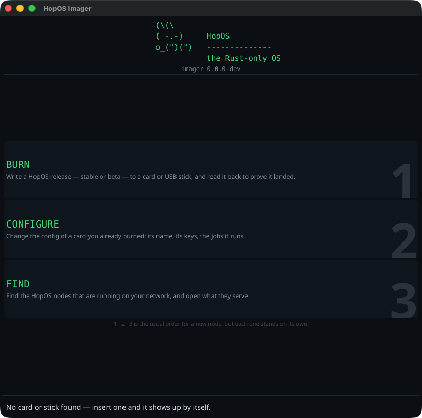

# hop-imager

The desktop tool for [HopOS](https://gethop.org) nodes: **burn** a card,
**configure** it, and **find** your nodes on the network. One window, three
steps, no terminal.

```
   (\(\
   ( -.-)     HopOS
   o_(")(")   --------------
              the Rust-only OS
```

HopOS is a bare-metal operating system for edge computing, written in Rust
since v3: no Linux, one static binary *is* the OS, and every app runs in its
own hardware-enforced partition on its own core. Its source lives in
[hop-os/HopOS](https://github.com/hop-os/HopOS); the orchestrator that runs on
it, Hop, in [hop-os/hop](https://github.com/hop-os/hop). This tool is the
part you run on your laptop.

## One thing at a time



You start by choosing *what you are doing*, because these three never happen at
the same time: you burn a card, or you change a config, or you look for a node.
Each button says in one line what it does, and only then do you get the tools for
that job — with a back arrow (or Escape) to return. The 1-2-3 in the corner is
the order a new node goes through, not a wizard: steps 2 and 3 stand on their
own.

### BURN — write a card


**RELEASE** is the first line, because HopOS also ships betas now and then "the
latest release" stops being an answer. It says which channel you are looking at
— `stable` in phosphor, `beta` in copper — with the version number behind it,
and that version number is the selector: every HopOS release that carries card
images is in the list, newest first, so you can also go back to the version your
other nodes run.

The tool opens on the **newest stable**. A beta is something you choose, not
something that happens to you.

Pick the **type** next. HopOS v3 builds every board in two flavours:
*Headless* is a kernel with no GUI linked at all — API plus network console —
and *Headfull* is the kernel with the GUI, plus the hardware video codec and
USB optical drives on the Radxa Orion O6N, the one board with a codec block.
The tool opens on Headless, because every board has it. Then pick your
**board**; version, type and board together select the image, so switching one
of the three keeps the other two and fetches the matching file. A board
without that flavour stays visible but disabled (the LicheeRV Nano and the Mac
mini M4 are headless-only: their kernel has no GUI feature — a fact about the
port, not a missing download).

The Go releases (HopOS v2) are still in the version list, with the three types
they had: *Desktop*, *Headless* and *Media*. The buttons follow the version
you pick, and switching between a v2 and a v3 version keeps the kind of card
you chose — Headfull becomes Desktop and back, and your board stays selected
even where v3 renamed it (`radxa-zero3` is `radxa` now, `m4` is `apple`).

| Board | Headless | Headfull |
|---|---|---|
| Raspberry Pi 4 / 5 | yes | yes |
| Radxa Zero 3E | yes | yes |
| Radxa Orion O6N (USB stick) | yes | yes, with codec and optical drives |
| Ampere Altra (USB stick) | yes | yes |
| Mac mini M4 (installer stick) | yes | — |
| LicheeRV Nano | yes | — |

The Mac mini stick is not a boot medium: it carries the image, an installer
and a README. Boot the mini into Recovery and run
`sh /Volumes/HOPOS/install.sh go`; from then on it powers on into HopOS.

The image is downloaded once and cached. Insert a card or a USB stick and it
appears in **TARGET** by itself; if it is the only one, it is already selected.

**Write + verify** is one button because it is one job: the card is written,
then read back and compared to the image byte for byte on the same open device,
before anything can mount it. That is the only moment the answer means
something — verify a minute later and you are comparing against bytes the
operating system wrote itself the instant it mounted your fresh card.

**Keep this card's config** is on by default, because that is what updating a
node should do: new code, same node. Before a single byte is written the tool
reads the config that is already on the card, saves a copy on your machine, and
puts it back into the fresh image afterwards — so the node keeps its name, its
API key, its S3 credentials and its jobs. The whole sequence lives in one open
device: read, back up, write, verify, restore. One authorization, and the
verification still means what it says (the config goes back *after* the
comparison, otherwise the card would legitimately differ from the image).

It keeps your config **verbatim**. A config is a decision you made, and quietly
merging it with a newer default would change decisions — with repeatable lines
like `hopos.init[]` there is no honest merge anyway. Instead the tool tells you
what the new default sets that your config lacks, so you can add it in CONFIGURE
if you want it. It also warns when your kept config gives the screen to the
display app but the image you just wrote is headless: that job would never get
the framebuffer.

The config window of a v3 kernel is 16 KiB (a Go card carried 1 MiB). A
config that does not fit is not cut short: the card keeps the image's default,
the tool says so, and your own config is in the backup.

The backup lands in your user config directory with mode `0600` — it contains
your keys, in plain text, and the tool names the file in the log so that is never
a surprise. A flash that dies halfway can never eat your API key.

### CONFIGURE — change the node config, afterwards


Configuring is not part of writing. You write a card once and re-configure it
as often as you like: node name, cluster, API key, console port, the jobs it
should seed at boot. Select the target and **the config appears** — no load
button, no dialog. Edit, save, put the card back in the node.

The config is coloured for what this format actually has, nothing more: section
headers in phosphor, comments muted, keys blue, values white, JSON job lines
with their strings and numbers apart — and **secrets in copper** (`hopos.apikey`,
`hopos.s3.key`, `hopos.s3.secret`, `hopos.lock.apikey`), so a config open on
your screen shows you where its keys are.

The tag next to it says `headfull` when the config seeds the display app or
*welcome*, `headless` otherwise. That is an educated guess: in v3 the kernel
decides whether a node has a GUI, not a line in its config.

The colours are there **while you type** — there is no view mode to leave. The
text field is a real text field (selection, clipboard, undo, mouse) with
invisible letters, laid exactly over a coloured copy of the same text; every
keystroke recolours it, which costs under a millisecond for a 7 KB config. So a
half-finished job line or a value you moved into a comment shows up the moment
you type it.

It works on a card that no operating system can mount, and on every board's
kernel, because the tool never touches a filesystem — see the next section.

### FIND — where is that thing on my network?


A HopOS node serves its console on `tcp/5555`, and hands over its retained
boot log the moment you connect. So a single TCP connect both identifies a node
*and* tells you its name, architecture, HopOS version, type and state — no
mDNS, no broadcast, no extra code on the node. Nodes appear while the scan is
still running, so a network full of them fills up as you watch.

In v3 that console port is a choice: `hopos.console=1` or `hopos.insecure=1`
opens it, and both shipped configs (`headless.cfg` and `headfull.cfg`) set
both. A node you locked down — an API key, `hopos.insecure=0` and no
`hopos.console=1` — keeps its console on the serial line only, and FIND will
not see it. That is the point of locking it down.

The console is a ring of 32 KiB, though. A v3 node that has run for a few
hours has pushed its boot out of it, and after a kernel flip Hop is not
restarted at all. So once a node has shown itself as HopOS on 5555, FIND also
asks Hop: `GET :8080/v1/agents` gives the node's name and HopOS version, days
after the boot. A `200` means Hop is up and its API is open; a `401` means Hop
is up with a key, and then that is all FIND learns. Whatever the node no longer
says (the architecture, whether it has a GUI) is left out instead of guessed.

Otherwise the state comes from the markers the kernel and Hop print:
`hop starting` before Hop reports `HOP_UP`, `parked — no api key set` when Hop
refuses its API for lack of a key, and `hop down` when Hop fell over. Go nodes
(v2) are still recognised, and show as such.

Click a row to read that node's console. **Web** opens what the node serves on
port 80 (*welcome*, which `headfull.cfg` seeds, or whatever a job publishes
there; on a Go desktop node, its own screen at `/kvm`). It is enabled only when
something answers on port 80. **Manage** hands its name and address to gui.gethop.org.
Neither ever carries a key — this tool has none, knows none and puts none in a
URL.

## Why the config edit always works

HopOS images carry their config as a fixed-size **config window**: a magic
first line, the config, and `#`-comment padding.

```
#HOPCFG1 window=16384 len=0000001160
hopos.cluster=hopos
hopos.insecure=1
hopos.console=1
...
################################################################   (padding)
```

To every config parser that is just a config file with comments in it. To this
tool it is a block of bytes that can be rewritten **in place** — so editing
works before flashing (on the image) and after (on the card), without mounting
anything, and regardless of whether your OS can mount the boot partition at
all.

In v3 the window sits **inside the kernel itself**, on every board: 16 KiB on
a 4 KiB boundary, in the kernel binary on the card, on the UEFI stick, in the
Mac mini's boot object, in the LicheeRV's FIP and in a flip bundle alike. One
imager fills all of them by finding the header line. On the LicheeRV Nano the
tool also fixes the Sophgo FIP checksums that guard it. (The Go generation kept
the window on the card, as a 1 MiB `hopos.cfg` in the FAT; the tool still reads
and writes those.)

The same format is read and written from the command line by `hop image` in
[hop-os/hop](https://github.com/hop-os/hop) and by `image/hopcfg.py` in
[hop-os/HopOS](https://github.com/hop-os/HopOS). The keys themselves are
documented in `kern/src/nodecfg.rs` there; a config of your own is the
flavour's default with your lines after it — the last value of a key wins.

## Privileges

Writing a card and reading its config window need raw access to the device.

On **macOS** that is not a matter of being root: even Apple's own `dd` is
refused as uid 0, because the restriction is TCC and it looks at the process,
not the user. The tool therefore uses `/usr/libexec/authopen`, Apple's own
signed helper, which asks for permission itself and hands back an open file
descriptor. So there is no `sudo`, no second process, and the progress bar keeps
working — one authorization dialog per operation.

On **Linux**, root is enough: run it with `sudo`, or add yourself to the `disk`
group. Unmounting goes through `udisksctl` first (which polkit allows for a
normal user) and falls back to `umount`.

## Build and run

On macOS, build the **app bundle** — that is not cosmetic. Since Sequoia, macOS
requires an app to be allowed on the local network, and a loose binary has no
identity to hang that permission on: every connection to a LAN peer then fails
instantly with "no route to host", so FIND sees an empty network instead of
your nodes. (The gateway and your own machine are exempt, which is exactly why
the failure is so confusing.)

```sh
./make-app.sh
open "HopOS Imager.app"      # approve the local-network prompt on first scan
```

Plain build, fine for BURN and CONFIGURE:

```sh
go build .
./hop-imager
```

Command line, no GUI needed:

```sh
./hop-imager -scan      # list HopOS nodes on this network, with their version
./hop-imager -releases  # the versions BURN offers, and the one it opens on (*)
```

## Platform support

| | BURN | CONFIGURE | FIND | what it needs |
|---|---|---|---|---|
| macOS | yes | yes | yes | run the **app bundle** (local-network permission) |
| Linux | yes | yes | yes | root: `sudo ./hop-imager`, or the `disk` group |
| Windows | yes | yes | yes | administrator (the app offers to restart elevated) |

Each platform reaches its devices its own way, and every one of those ways is a
constraint the operating system imposes rather than a style choice:

- **macOS** — `diskutil` for enumeration and unmounting, `authopen` for the raw
  descriptor (being root is not enough; TCC looks at the process).
- **Linux** — `lsblk` for enumeration, `udisksctl`/`umount` for unmounting, and
  plain `open` as root.
- **Windows** — WMI for enumeration, and before a single byte goes to
  `\\.\PhysicalDriveN` every volume on that disk is opened, `FSCTL_LOCK_VOLUME`d
  and `FSCTL_DISMOUNT_VOLUME`d, with those handles **held open for the whole
  write** — otherwise Windows remounts the volume mid-flash and writes its own
  filesystem over yours. Afterwards the locks are released and the disk is told
  to re-read its partition table.

## Releases

The tool itself lives at [hop-os/hop-imager](https://github.com/hop-os/hop-imager).
Numbered releases stay put; the **rolling-release** tag always carries the
newest build at a URL that never changes — the same arrangement HopOS uses for
its apps. Pushing a `v*` tag builds all platforms on native runners and fills
both.

The card images come from the releases of
[hop-os/HopOS](https://github.com/hop-os/HopOS) (`release.Repo`): every
release with `.img`/`.img.gz` assets is in BURN's list.

## License

MIT — see [LICENSE](LICENSE).
