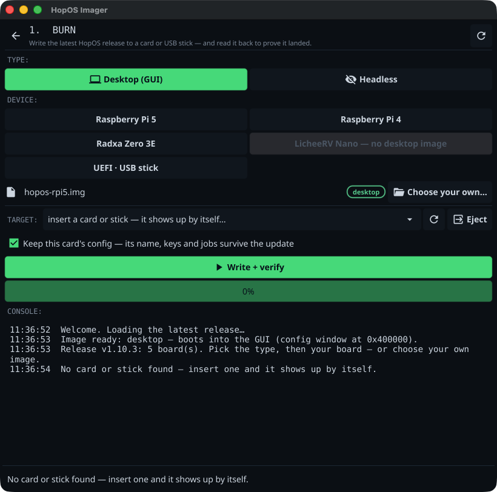
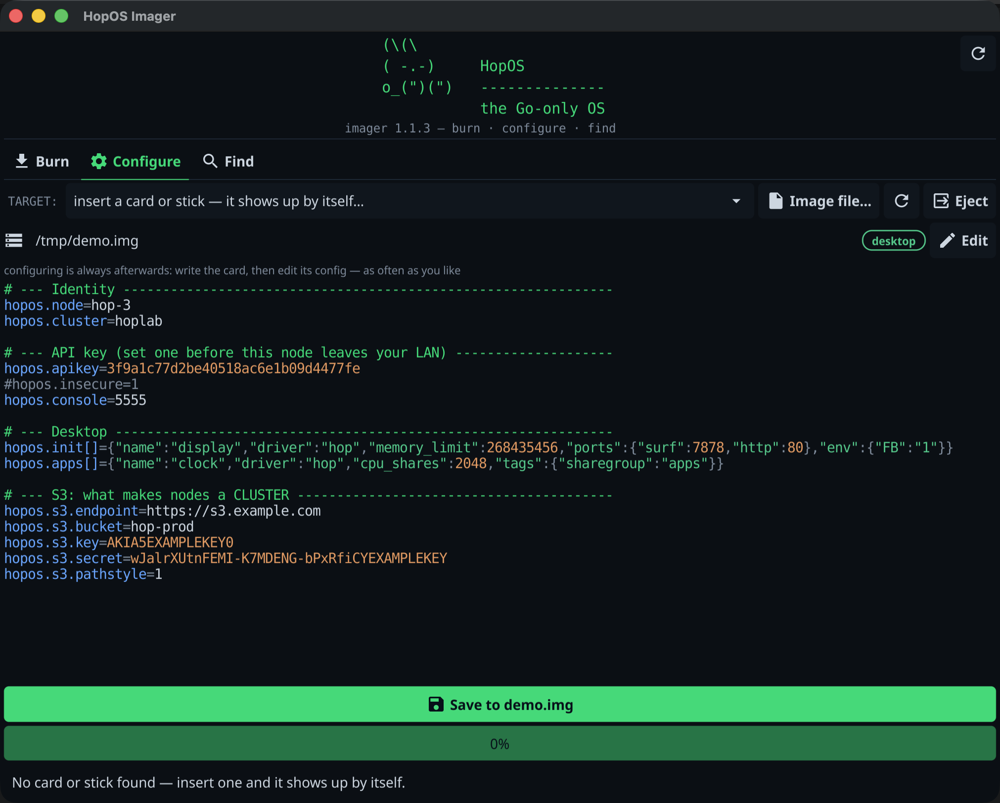
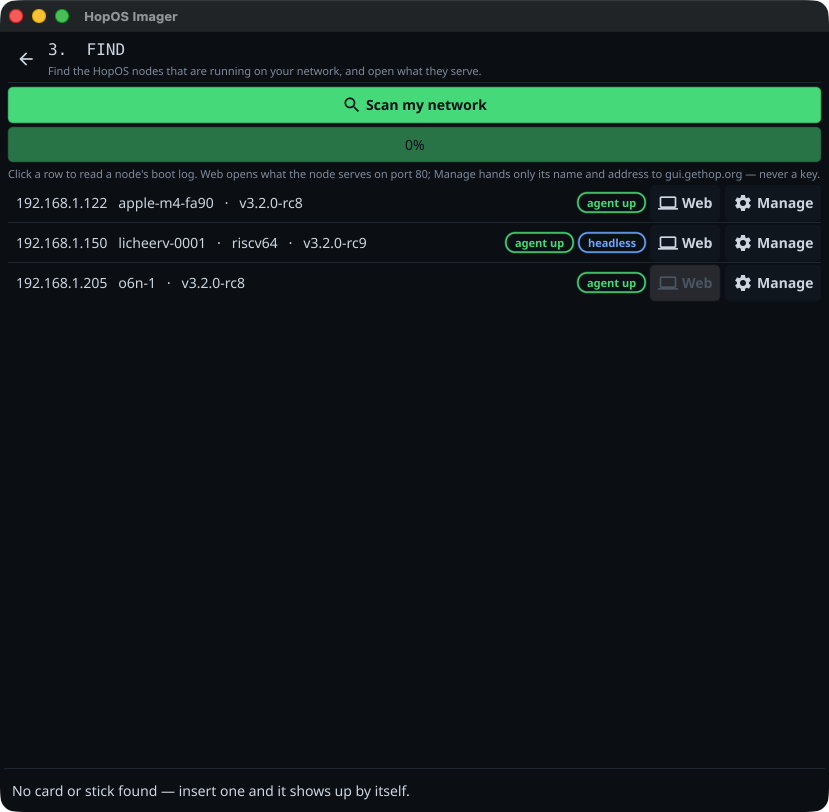

# hop-imager

The desktop tool for [HopOS](https://gethop.org) nodes: **burn** a card,
**configure** it, and **find** your nodes on the network. One window, three
tabs, no terminal.

```
   (\(\
   ( -.-)     HopOS
   o_(")(")   --------------
              the Go-only OS
```

## The three tabs

### BURN — write a card



Pick the **type** first: *Desktop* boots into the HopOS GUI, *Headless* is a
node with no display code linked at all — API plus network console. Then pick
your **board**; both choices together select the image, so switching type keeps
your board and fetches the other flavour. A board without that flavour stays
visible but disabled (the LicheeRV Nano has no desktop image — that is a fact
about the silicon, not a missing download).

The image comes from the latest HopOS release on GitHub, downloaded once and
cached. Insert a card or a USB stick and it appears in **TARGET** by itself; if
it is the only one, it is already selected.

**Write + verify** is one button because it is one job: the card is written,
then read back and compared to the image byte for byte on the same open device,
before anything can mount it. That is the only moment the answer means
something — verify a minute later and you are comparing against bytes the
operating system wrote itself the instant it mounted your fresh card.

**Keep this card's config** is on by default, because that is what updating a
node should do: new code, same node. Before a single byte is written the tool
reads the config that is already on the card, saves a copy on your machine, and
puts it back into the fresh image afterwards — so the node keeps its name, its
API key, its S3 credentials and its jobs. The whole sequence lives in one open
device: read, back up, write, verify, restore. One authorization, and the
verification still means what it says (the config goes back *after* the
comparison, otherwise the card would legitimately differ from the image).

It keeps your config **verbatim**. A config is a decision you made, and quietly
merging it with a newer default would change decisions — with repeatable lines
like `hopos.init[]` there is no honest merge anyway. Instead the tool tells you
what the new default sets that your config lacks, so you can add it in CONFIGURE
if you want it. It also warns when your kept config seeds a desktop but the
image you just wrote is headless: that display job would never get the
framebuffer.

The backup lands in your user config directory with mode `0600` — it contains
your keys, in plain text, and the tool names the file in the log so that is never
a surprise. A flash that dies halfway can never eat your API key.

### CONFIGURE — change the node config, afterwards



Configuring is not part of writing. You write a card once and re-configure it
as often as you like: node name, cluster, API key, console port, the jobs it
should seed at boot. Select the target and **the config appears** — no load
button, no dialog. Edit, save, put the card back in the node.

It works on a card that no operating system can mount, and on a board whose
config lives inside the kernel, because the tool never touches a filesystem —
see the next section.

### FIND — where is that thing on my network?



Every HopOS node serves its console on `tcp/5555`, and hands over its retained
boot log the moment you connect. So a single TCP connect both identifies a node
*and* tells you its name, architecture, type and state — no mDNS, no broadcast,
no extra code on the node. Nodes appear while the scan is still running, so a
network full of them fills up as you watch.

Click a row to read that node's boot log. **GUI** opens the node's own screen
(`/kvm`); **Manage** hands its name and address to gui.gethop.org. Neither ever
carries a key — this tool has none, knows none and puts none in a URL.

## Why the config edit always works

HopOS images carry their config as a fixed-size **config window**: a magic
first line, the config, and `#`-comment padding.

```
#HOPCFG1 window=1048576 len=0000005179
hopos.node=hop-1
hopos.console=5555
...
################################################################   (padding)
```

To every config parser that is just a config file with comments in it. To this
tool it is a block of bytes that can be rewritten **in place** — so editing
works before flashing (on the image) and after (on the card), without mounting
anything, and regardless of whether your OS can mount the boot partition at
all. On the LicheeRV Nano, where the config lives inside the kernel, the tool
also fixes the Sophgo FIP checksums that guard it.

The same format is written by HopOS's own `image/mkcard -cfgwindow` and can be
edited from the command line with `image/hopcfg` in the
[HopOS repository](https://github.com/xinix00/HopOS).

## Privileges

Writing a card and reading its config window need raw access to the device.

On **macOS** that is not a matter of being root: even Apple's own `dd` is
refused as uid 0, because the restriction is TCC and it looks at the process,
not the user. The tool therefore uses `/usr/libexec/authopen`, Apple's own
signed helper, which asks for permission itself and hands back an open file
descriptor. So there is no `sudo`, no second process, and the progress bar keeps
working — one authorization dialog per operation.

On **Linux**, root is enough: run it with `sudo`, or add yourself to the `disk`
group. Unmounting goes through `udisksctl` first (which polkit allows for a
normal user) and falls back to `umount`.

## Build and run

On macOS, build the **app bundle** — that is not cosmetic. Since Sequoia, macOS
requires an app to be allowed on the local network, and a loose binary has no
identity to hang that permission on: every connection to a LAN peer then fails
instantly with "no route to host", so FIND sees an empty network instead of
your nodes. (The gateway and your own machine are exempt, which is exactly why
the failure is so confusing.)

```sh
./make-app.sh
open "HopOS Imager.app"      # approve the local-network prompt on first scan
```

Plain build, fine for BURN and CONFIGURE:

```sh
go build .
./hop-imager
```

Command line, no GUI needed:

```sh
./hop-imager -scan      # list HopOS nodes on this network
```

## Platform support

| | BURN | CONFIGURE | FIND |
|---|---|---|---|
| macOS | yes | yes | yes (run the app bundle) |
| Linux | yes, as root | yes, as root | yes |
| Windows | not yet | image files only | yes |

Windows is the one still waiting: opening `\\.\PhysicalDriveN` needs a
`FSCTL_LOCK_VOLUME`/`DISMOUNT_VOLUME` dance per volume on top of UAC, and that
deserves to be written with a Windows machine next to it rather than guessed.
Everything above the device layer is already platform-neutral — it is one file
(`internal/disk`) plus raw open in `internal/priv`.

## Releases

Numbered releases stay put; the **rolling-release** tag always carries the
newest build at a URL that never changes — the same arrangement HopOS uses for
its images and SURF for its apps. Pushing a `v*` tag builds all platforms on
native runners and fills both.

## License

MIT — see [LICENSE](LICENSE).
